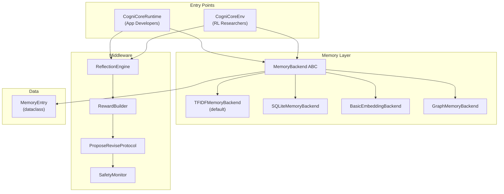

# Contributing to CogniCore NEXUS

Thank you for your interest in contributing to CogniCore NEXUS! Whether you're fixing a bug, adding a memory backend, building an integration, or improving docs — every contribution matters.

This guide covers everything you need to go from fork to merged PR.

---

## Table of Contents

- [Getting Started](#getting-started)
- [Architecture Overview](#architecture-overview)
- [Module Map](#module-map)
- [How to Add a New Memory Backend](#how-to-add-a-new-memory-backend)
- [How to Add a New Environment](#how-to-add-a-new-environment)
- [How to Add an Integration](#how-to-add-an-integration)
- [Testing Conventions](#testing-conventions)
- [Code Style](#code-style)
- [Pull Request Process](#pull-request-process)
- [Release Process](#release-process)

---

## Getting Started

1. **Fork** the repository on GitHub: [github.com/cognicore-dev/cognicore-my-openenv](https://github.com/cognicore-dev/cognicore-my-openenv)

2. **Clone your fork** locally:
   ```bash
   git clone https://github.com/YOUR_USERNAME/cognicore-my-openenv.git
   cd cognicore-my-openenv
   ```

3. **Install in development mode** with all dev dependencies:
   ```bash
   pip install -e ".[dev]"
   ```

4. **Verify everything works** by running the test suite:
   ```bash
   pytest tests/
   ```
   All tests should pass (currently 660+). If any fail, please open an issue before proceeding.

5. **Create a feature branch**:
   ```bash
   git checkout -b feature/your-feature-name
   ```

---

## Architecture Overview

CogniCore NEXUS provides runtime cognition — memory, reflection, and adaptive execution — for AI agents. There are two entry points that share the same middleware pipeline:

| Entry Point | Audience | Purpose |
|---|---|---|
| `CogniCoreRuntime` | Application developers | Wraps any callable agent with memory + reflection |
| `CogniCoreEnv` | RL researchers | Gymnasium-compatible environments for training agents |



**Key design principles:**

- **`MemoryBackend`** is an abstract base class (ABC). All memory implementations subclass it and implement the same 5 methods.
- **`MemoryEntry`** is the canonical data type — a Python dataclass, not a raw dict.
- Both entry points feed into the same middleware chain: `ReflectionEngine → RewardBuilder → ProposeReviseProtocol → SafetyMonitor`.

---

## Module Map

### The `cognicore` package (what ships on PyPI)

| Directory | Purpose | Key files |
|---|---|---|
| `cognicore/runtime.py` | `CogniCoreRuntime`, the universal cognition wrapper | |
| `cognicore/cli.py` | The `cognicore` command | |
| `cognicore/core/` | Base environment, types, spaces, errors, config profiles | `base_env.py`, `types.py`, `api.py`, `profiles.py` |
| `cognicore/memory/` | Memory backend ABC, all backends, semantic and multi-tier memory | `base.py`, `sqlite_backend.py`, `tfidf_backend.py`, `semantic.py`, `manager.py`, `multi_tier.py` |
| `cognicore/experience/` | Structured, verified experience memory | `manager.py`, `schema.py`, `verification.py` |
| `cognicore/middleware/` | Reflection, rewards, propose-revise, safety monitor | `reflection.py`, `rewards.py`, `safety_monitor.py` |
| `cognicore/agents/` | Built-in agents, agent builder, persistence, lifelong learning, swarms | `base_agent.py`, `smart.py`, `builder.py`, `persistence.py` |
| `cognicore/envs/` | Environments, the registry, pipelines, multi-agent base | `registry.py`, `compose.py`, `multi_agent_base.py` |
| `cognicore/safety/` | Safety layer, adversarial testing, red vs blue | `layer.py`, `adversarial.py`, `red_blue.py` |
| `cognicore/evaluation/` | Benchmarking agents, leaderboards, analytics, reports, A/B experiments | `benchmark.py`, `leaderboard.py`, `analytics.py`, `report.py` |
| `cognicore/training/` | Curricula, evolution, auto-improvement, reward tuning, fine-tuning export | `curriculum.py`, `evolution.py`, `finetuning.py` |
| `cognicore/observability/` | Debugger, explainer, thought traces, failure prediction, cost, alerts | `debugger.py`, `explainer.py`, `cost_tracker.py` |
| `cognicore/replay/` | Recording, replay and branching | `recorder.py`, `replayer.py`, `brancher.py` |
| `cognicore/immune/` | Agent immune system (threat detection) | `shield.py`, `detector.py` |
| `cognicore/connectors/` | Hosted MCP servers: the Claude connector and the ChatGPT app | `remote.py`, `oauth.py`, `chatgpt.py` |
| `cognicore/extension/` | Local Claude Desktop extension (stdio MCP) and Claude Code setup | `server.py`, `code_setup.py` |
| `cognicore/mcp/` | Local MCP server for the full runtime (`cognicore mcp serve`) | `server.py` |
| `cognicore/server/` | REST API (`cognicore serve`) | `app.py` |
| `cognicore/fabric/` | Cognitive Fabric adapters for third-party tools | `plugins/figma.py`, `plugins/elevenlabs.py` |
| `cognicore/integrations/` | Framework bridges: LangChain, CrewAI, mem0, OpenAI Agents, Hugging Face | `langchain.py`, `crewai.py`, `mem0/` |
| `cognicore/nexus/` | NEXUS autonomous coding agent | `agent.py`, `run.py` |
| `cognicore/nexus/triggers/` | What starts NEXUS: task queue, GitHub issues, CI, Slack, Linear, schedules | `task_queue.py`, `webhook_server.py` |
| `cognicore/benchmarks/` | Regression benchmark suite used by `make bench` and CI | `suite.py`, `regression.py` |
| `cognicore/ui/` | Dashboard, memory studio, web UI server | `dashboard.py`, `studio.py`, `server.py` |
| `cognicore/experimental/` | Dream, Oracle, TimeTravel, Civilization, Conscience, DNA (APIs may change) | |
| `cognicore/utils/` | Caching, rate limiting, SQLite helpers | `cache.py`, `rate_limiter.py` |

Other packages: `adapters/`, `commerce/`, `decision/`, `gym/`, `llm/`, `logging/`, `passport/`, `realbench/`, `reflection/`, `rendering/`, `research/`, `rl/`.

**Old import paths still work.** Modules that moved in the restructure (for
example `cognicore.advanced_memory`, now `cognicore.memory.semantic`) are aliased
in [`cognicore/_compat.py`](cognicore/_compat.py), which lists every move. Use the new paths in new code.

### The rest of the repository

| Path | What it is |
|---|---|
| `tests/` | The test suite (`make test`) |
| `benchmarks/` | Benchmark harnesses: LongMemEval (`longmemeval/`, `data/`, `common/`), agent-learning experiments (`agent_learning/`), and standalone scripts |
| `examples/` | Runnable examples and demos (`walkthrough/`, `standalone/`, `experience_transfer/`, `launch/`) |
| `plugins/` | Claude client packages: the Claude Code plugins and the Desktop extension (see `plugins/README.md`) |
| `docs/` | Documentation; `docs/internal/` holds audits, plans and the progress log |
| `scripts/` | Developer scripts: `checks/` (verification), `analysis/`, `probes/`, `dev/` |
| `content_studio/` | Content Studio app |
| `env/`, `server/`, `openenv.yaml`, `inference.py`, `dashboard.html` | The OpenEnv AI Safety Monitor environment. These stay at the root because the OpenEnv format expects them there. |
| `api/`, `public/` | Vercel deployment (serverless function and static page) |
| `deploy/` | How the hosted server actually runs: Docker Compose, the Caddy reverse proxy, host setup and the backup script (see `docs/remote-mcp-server.md`) |
| `Dockerfile` | Image for the hosted server (`cognicore.connectors.remote`), used by `deploy/docker-compose.yml` |
| `railway.toml`, `render.yaml`, `fly.toml`, `Procfile` | Configs kept for platforms that build from the `Dockerfile` |

Generated output (`results/`, `benchmark_output/`, `experiments/`, `cognicore_data/`) is git-ignored.

### Moving files safely

`scripts/checks/restructure_guard.py` snapshots how the code behaves (every
test result, every module import, every first-party import statement, the
public API, the CLI and each deployable app's `/health`) and compares two
snapshots:

```bash
python scripts/checks/restructure_guard.py snapshot before.json
# ... move files, add the old path to cognicore/_compat.py ...
python scripts/checks/restructure_guard.py snapshot after.json
python scripts/checks/restructure_guard.py compare before.json after.json
```

---

## How to Add a New Memory Backend

Adding a new memory backend (e.g., Redis, Pinecone, Qdrant) is one of the best first contributions.

### Step 1: Subclass `MemoryBackend`

Create a new file in `cognicore/memory/`:

```python
# cognicore/memory/redis.py
from typing import Dict, List, Optional

from cognicore.memory.base import MemoryBackend, MemoryEntry, MemoryScope, SearchResult


class RedisMemoryBackend(MemoryBackend):
    """Redis-backed memory storage for CogniCore agents."""

    def __init__(self, redis_url: str = "redis://localhost:6379"):
        self.redis_url = redis_url
        # ... connection setup
```

### Step 2: Implement the 5 required methods

Every `MemoryBackend` subclass must implement:

| Method | Signature | Purpose |
|---|---|---|
| `store` | `store(entry: MemoryEntry) -> str` | Persist a memory entry and return its entry id |
| `search` | `search(query: str, top_k: int = 5, category=None, scope=None, scope_id=None, question_timestamp=None, metadata_filters=None) -> List[SearchResult]` | Semantic + category search; returns ranked results |
| `get_by_category` | `get_by_category(category: str, top_k: int = 5, success_filter=None) -> List[MemoryEntry]` | Category-exact retrieval with optional success filter |
| `count` | `count() -> int` | Return total number of entries |
| `clear` | `clear() -> None` | Remove all stored entries |

```python
def store(self, entry: MemoryEntry) -> str:
    """Store a MemoryEntry in Redis and return its entry_id."""
    ...

def search(self, query: str, top_k: int = 5,
           category: Optional[str] = None,
           scope: Optional[MemoryScope] = None,
           scope_id: Optional[str] = None,
           question_timestamp: Optional[float] = None,
           metadata_filters: Optional[Dict[str, str]] = None) -> List[SearchResult]:
    """Search for relevant memories."""
    ...

def get_by_category(self, category: str, top_k: int = 5,
                    success_filter: Optional[bool] = None) -> List[MemoryEntry]:
    """Retrieve entries filtered by category."""
    ...

def count(self) -> int:
    """Return the number of stored entries."""
    ...

def clear(self) -> None:
    """Remove all entries from the store."""
    ...
```

### Step 3: Register in `__init__.py`

Add your backend to `cognicore/memory/__init__.py`:

```python
from cognicore.memory.redis import RedisMemoryBackend

__all__ = [
    ...,
    "RedisMemoryBackend",
]
```

### Step 4: Add tests

Create `tests/test_redis_memory_backend.py`:

```python
import pytest
from cognicore.memory.redis import RedisMemoryBackend
from cognicore.memory.base import MemoryEntry


@pytest.fixture
def backend():
    backend = RedisMemoryBackend()
    backend.clear()
    yield backend
    backend.clear()


def test_store_and_retrieve(backend):
    entry = MemoryEntry(text="test data", category="test")
    backend.store(entry)
    results = backend.get_by_category("test", top_k=5)
    assert len(results) == 1
    assert results[0].text == "test data"


def test_search(backend):
    entry = MemoryEntry(text="important finding", category="research")
    backend.store(entry)
    results = backend.search("important", top_k=3)
    assert len(results) >= 1
    assert results[0].entry.text == "important finding"


def test_clear(backend):
    backend.store(MemoryEntry(text="temp", category="test"))
    backend.clear()
    assert backend.count() == 0
```

> **Important:** Use `MemoryEntry` dataclass instances — never raw dicts. Use the concrete backend class name (e.g., `TFIDFMemoryBackend`), not the old `Memory` alias.

---

## How to Add a New Environment

Environments follow the Gymnasium pattern and live in `cognicore/envs/`.

### Step 1: Subclass `CogniCoreEnv`

```python
# cognicore/envs/my_task.py
from typing import Any, Dict, List

from cognicore.core.base_env import CogniCoreEnv
from cognicore.core.types import EvalResult


class MyTaskEnv(CogniCoreEnv):
    """Environment for [describe your task domain]."""

    def _setup(self, **kwargs: Any) -> None:
        """Configure observation/action spaces and load task data."""
        ...

    def _generate_tasks(self) -> List[Any]:
        """Return the tasks for the current episode."""
        ...

    def _evaluate(self, action: Dict[str, Any]) -> EvalResult:
        """Grade the agent's action and return an EvalResult."""
        ...

    def _get_obs(self) -> Dict[str, Any]:
        """Return the domain-specific observation fields."""
        ...
```

### Step 2: Register in the environment registry

Add your environment to the registry so it's available via `cognicore.make()`:

```python
# In cognicore/envs/__init__.py or the registry module
from cognicore.envs.registry import register

register(
    env_id="MyTask-v1",
    entry_point="cognicore.envs.my_task:MyTaskEnv",
)
```

### Step 3: Add difficulty variants

By convention, create Easy/Medium/Hard variants:

```python
for difficulty in ["Easy", "Medium", "Hard"]:
    register(
        env_id=f"MyTask{difficulty}-v1",
        entry_point="cognicore.envs.my_task:MyTaskEnv",
        default_kwargs={"difficulty": difficulty.lower()},
    )
```

### Step 4: Write tests

Create `tests/test_my_task_env.py` covering `reset()`, `step()`, reward structure, and episode termination.

---

## How to Add an Integration

CogniCore provides adapters for popular agent frameworks. Follow the existing pattern from the LangChain and CrewAI integrations.

### Pattern

```python
# cognicore/integrations/my_framework.py
from cognicore.runtime import CogniCoreRuntime
from cognicore.memory.tfidf_backend import TFIDFMemoryBackend


class MyFrameworkAdapter:
    """Adapter that wraps CogniCoreRuntime for use with MyFramework."""

    def __init__(self, runtime: CogniCoreRuntime | None = None, **kwargs):
        self.runtime = runtime or CogniCoreRuntime(
            memory=TFIDFMemoryBackend(),
            **kwargs,
        )

    def as_tool(self):
        """Export CogniCore memory/reflection as a tool for MyFramework agents."""
        ...

    def wrap_agent(self, agent):
        """Wrap a MyFramework agent with CogniCore cognition."""
        ...
```

### Checklist for integrations

- [ ] Adapter class in `cognicore/integrations/`
- [ ] Framework-specific dependency listed as an optional extra in `pyproject.toml`
- [ ] Graceful `ImportError` handling if the framework isn't installed
- [ ] Tests in `tests/test_integration_my_framework.py`
- [ ] Usage example in `examples/`

---

## Testing Conventions

CogniCore has **660+ tests** and we intend to keep them all green.

### File naming

- Test files: `test_*.py` (pytest discovery pattern)
- Place tests in the `tests/` directory, mirroring the source structure

### Key rules

| Do | Don't |
|---|---|
| Use `TFIDFMemoryBackend` (or other concrete backends) | Use the old `Memory` class name |
| Create `MemoryEntry(...)` dataclass instances | Pass raw `dict` objects to memory methods |
| Use `get_by_category()` for retrieval | Use deprecated `get_context()` or `retrieve()` |
| Test one behavior per test function | Write monolithic test functions |
| Use `pytest.fixture` for shared setup | Duplicate setup code across tests |

### Running tests

```bash
# Run all tests
pytest tests/

# Run a specific test file
pytest tests/test_tfidf_memory_backend.py

# Run with verbose output
pytest tests/ -v

# Run tests matching a pattern
pytest tests/ -k "memory"
```

### Marks

Use `@pytest.mark.slow` for tests that take >5 seconds (benchmarks, large datasets). These are excluded in CI fast-runs.

---

## Code Style

We use **Ruff** for linting and formatting.

### Configuration

| Setting | Value |
|---|---|
| Formatter | Ruff |
| Line length | **120** |
| Target Python | 3.10+ |
| Docstrings | Google style |

### Running Ruff

```bash
# Check for issues
ruff check .

# Auto-fix what's possible
ruff check . --fix

# Format code
ruff format .
```

### Docstring guidelines

Every public class and function should have a docstring:

```python
def search(self, query: str, top_k: int = 5) -> list[MemoryEntry]:
    """Search stored memories for entries relevant to the query.

    Args:
        query: The search string to match against stored memories.
        top_k: Maximum number of results to return.

    Returns:
        A list of MemoryEntry objects ranked by relevance.
    """
```

---

## Pull Request Process

1. **Create a branch** from `main`:
   ```bash
   git checkout -b feature/your-feature-name
   ```

2. **Make your changes** following the code style and testing conventions above.

3. **Run the full test suite** and ensure all 525+ tests pass:
   ```bash
   pytest tests/
   ```

4. **Run the linter** and fix any issues:
   ```bash
   ruff check . --fix
   ruff format .
   ```

5. **Commit with a clear message** using conventional commit format:
   ```
   feat(memory): add Redis memory backend
   fix(reflection): handle empty memory in ReflectionEngine
   docs: update CONTRIBUTING.md with new backend guide
   test(envs): add coverage for MyTaskEnv edge cases
   ```

6. **Push and open a PR** against `main`:
   ```bash
   git push origin feature/your-feature-name
   ```

7. **Fill out the PR template** with:
   - What the PR does and why
   - How to test the changes
   - Any breaking changes or migration notes

8. **Address review feedback** — we aim to review PRs within 48 hours.

### PR merge criteria

- [ ] All CI checks pass (tests, lint, type checks)
- [ ] At least one maintainer approval
- [ ] No unresolved review comments
- [ ] CHANGELOG.md updated (for user-facing changes)

---

## Release Process

Releases are managed by maintainers. Here's the process for reference:

1. **Update version** in `pyproject.toml`:
   ```toml
   [project]
   version = "0.9.5"
   ```

2. **Update `CHANGELOG.md`** with all changes under a new version heading, following [Keep a Changelog](https://keepachangelog.com/en/1.1.0/) format.

3. **Create a release commit**:
   ```bash
   git add pyproject.toml CHANGELOG.md
   git commit -m "release: v0.9.5"
   ```

4. **Tag the release**:
   ```bash
   git tag v0.9.5
   git push origin main --tags
   ```

5. **Publish to PyPI**:
   ```bash
   python -m build
   twine upload dist/*
   ```

6. **Create a GitHub Release** with release notes from the CHANGELOG entry.

---

## Questions?

- **Issues:** [github.com/cognicore-dev/cognicore-my-openenv/issues](https://github.com/cognicore-dev/cognicore-my-openenv/issues)
- **Discussions:** [github.com/cognicore-dev/cognicore-my-openenv/discussions](https://github.com/cognicore-dev/cognicore-my-openenv/discussions)

Thank you for helping make CogniCore NEXUS better! 🚀
