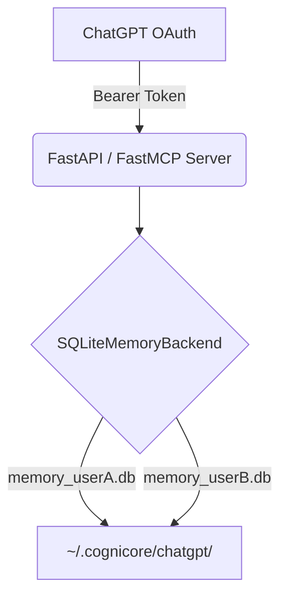
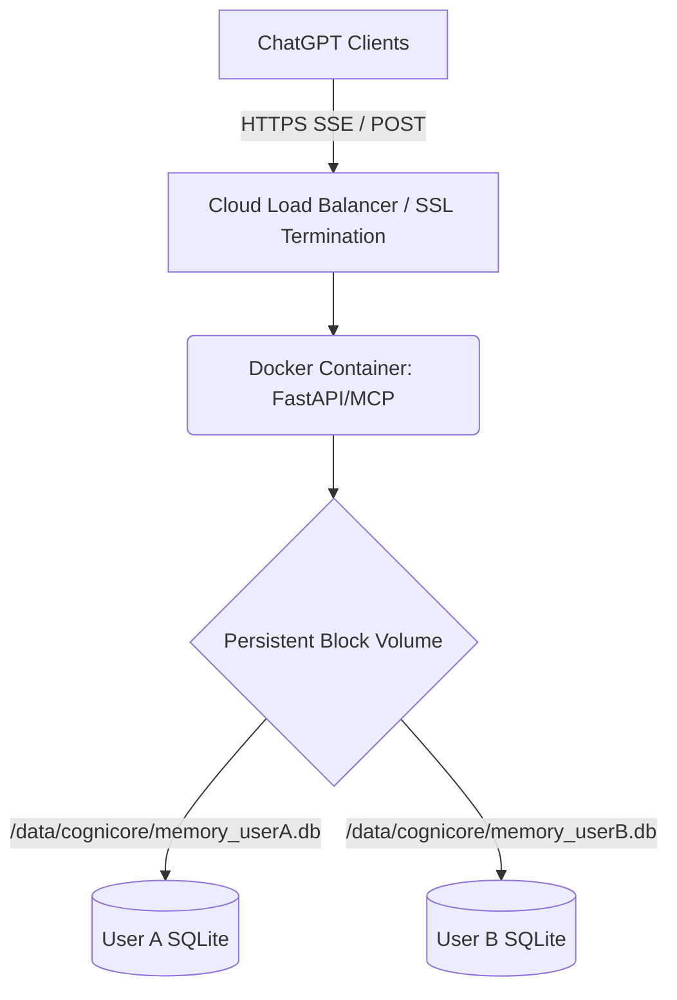

# CogniCore ChatGPT App Deployment Guide

This page covers the **ChatGPT** connector (`cognicore.connectors.chatgpt`), which signs users
in through Supabase. The Claude connector is a different server with its own sign-in and its
own deployment: see [remote-mcp-server.md](remote-mcp-server.md).

## 1. Local Architecture (Development)
During local development, the architecture consists of the FastAPI server running natively (or via Docker) mapping tenant data to a local `.cognicore/` folder.

## 2. Production Architecture (Cloud Deployment)
For production deployment, the App must be hosted behind a public HTTPS endpoint with a persistent volume attached to prevent data loss when the stateless container restarts.

### Environment Variables Required
* `SUPABASE_URL`: **Required.** The URL of your own Supabase project, e.g.
  `https://<project>.supabase.co`. It is used for JWKS fetching and to proxy the OAuth
  authorize and token endpoints. There is no default: without it those endpoints return
  `503`, rather than silently pointing at someone else's project.
* `COGNICORE_DATA_DIR`: Must be set to `/data/cognicore` (or wherever your persistent volume is mounted).

### Health Checks
The container exposes `GET /health` which returns `200 OK {"status": "ok"}` for load balancer readiness probes.
