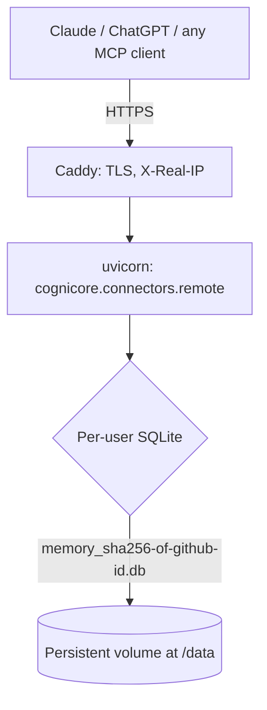

# Deploying CogniCore

CogniCore has one deployed server: the hosted MCP server in
`cognicore/connectors/remote.py`, running at `https://mcp.cognicoree.tech`.
**Claude and ChatGPT both connect to it**, through the same OAuth 2.1 sign-in.

For how to deploy it — the host setup, environment variables, Docker Compose,
TLS and the GitHub OAuth app — see
[remote-mcp-server.md](remote-mcp-server.md). This page covers only the shape
of the deployment and the pieces that are *not* part of it.

## Architecture

Each signed-in account gets its own database file, named with a one-way hash of
its account ID, so one user's tools cannot reach another user's data.

## What the deployment needs

| Requirement | Why |
|---|---|
| A persistent volume at `/data` | SQLite databases live in `$COGNICORE_DATA_DIR`; a stateless container loses every memory on restart |
| A local filesystem for that volume | SQLite locking is unreliable on SMB and NFS |
| HTTPS with a real certificate | MCP clients refuse plain HTTP, and OAuth redirects must match `COGNICORE_PUBLIC_URL` |
| `GET /health` reachable | Returns `{"status":"ok","version":"1.0"}` for readiness probes |

Everything host-specific lives in `deploy/.env` and DNS, so the same compose
file runs on any Linux host with Docker.

## Not deployed

Two other entry points exist in the repository. Neither is part of the hosted
service, and neither is required to run it:

- **`cognicore/connectors/chatgpt.py`** — an earlier ChatGPT connector that
  delegated sign-in to Supabase. It is not served anywhere: ChatGPT now
  connects to `remote.py` like every other client. It needs `SUPABASE_URL` set
  to a Supabase project of your own, and returns `503` from its OAuth
  endpoints without one. Kept for the import path only.
- **`cognicore/extension/server.py`** — the local stdio MCP server, which runs
  on the user's own machine rather than on a server. See
  [claude-desktop-extension.md](claude-desktop-extension.md).
